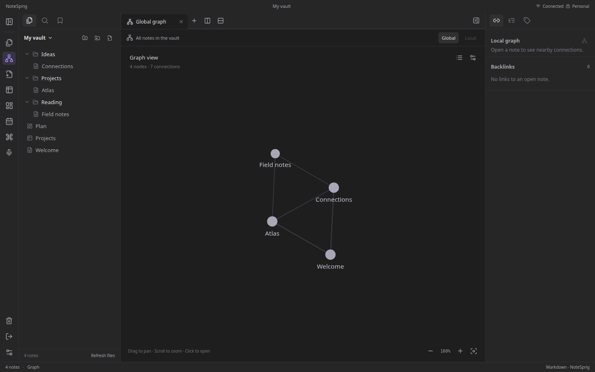
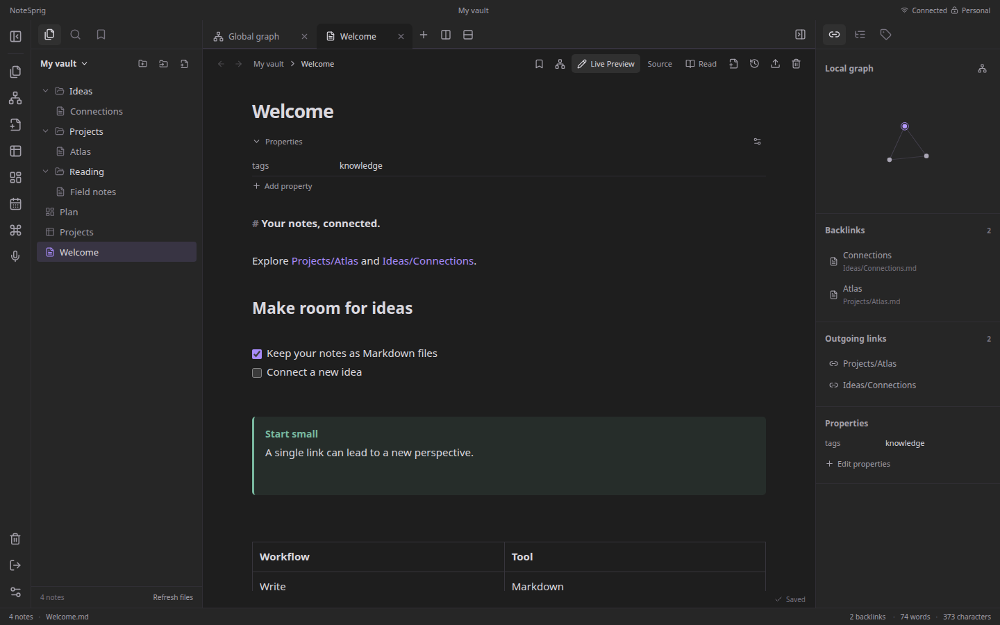
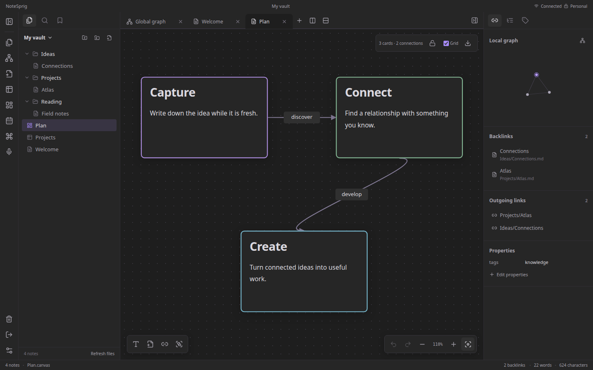
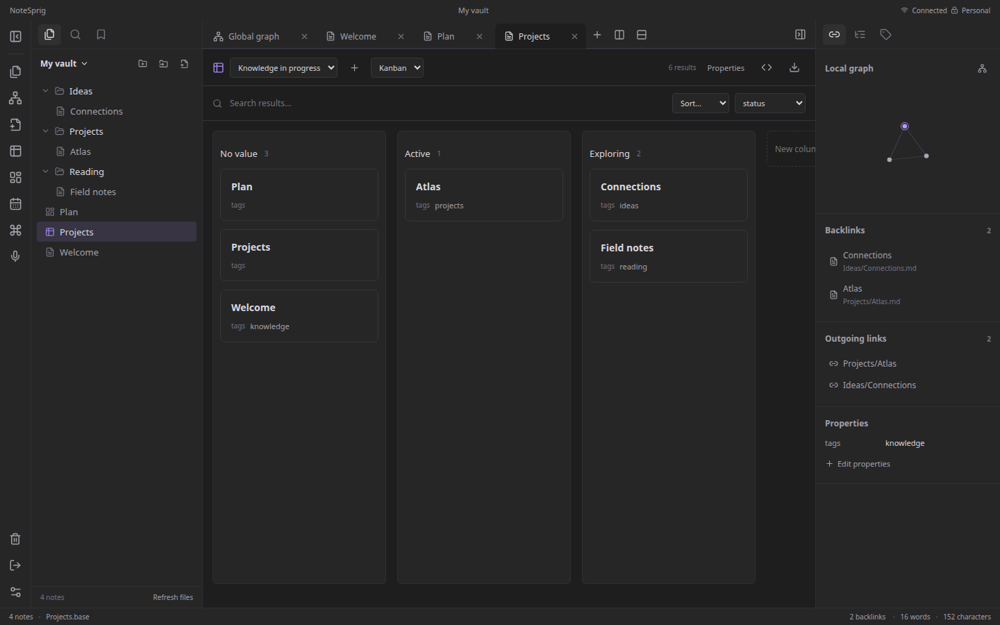
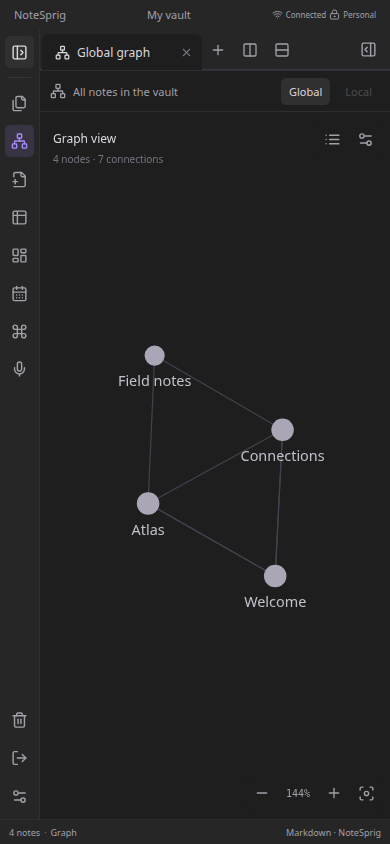

<p align="center">
  
</p>

<h1 align="center">NoteSprig</h1>

<p align="center"><strong>English</strong> · <a href="README.pt-BR.md" lang="pt-BR">Português (Brasil)</a></p>

<p align="center"><strong>Your notes, connected.</strong></p>

<p align="center">A self-hosted workspace for linked notes, visual thinking, and personal knowledge.</p>

<p align="center">
  <a href="#quick-start">Quick start</a> ·
  <a href="docs/deployment.md">Self-hosting</a> ·
  <a href="docs/user-guide.md">User guide</a> ·
  <a href="CONTRIBUTING.md">Contributing</a>
</p>



NoteSprig brings Markdown notes, a knowledge graph, visual canvases, and structured views into your browser. Keep your files on your own server and access the workspace from your computer or phone.

**Status:** early development. The interface is available in **English** and **Brazilian Portuguese**. AI integration is planned and is not included in this version.

## Features

- **Connected notes:** wikilinks, relative Markdown links, aliases, backlinks, heading and block references, tags, and search.
- **Markdown editing:** source mode, live preview, and reading mode, with properties, tasks, tables, callouts, syntax highlighting, math, and Mermaid diagrams.
- **Visual thinking:** global and local graphs with filters and force controls; canvases with cards, groups, and connections.
- **Structured views:** YAML-based tables, lists, cards, and Kanban boards with filters and formulas.
- **A flexible workspace:** folders, bookmarks, pinned tabs, split panes, templates, and daily notes.
- **Recovery and portability:** file history, trash, conflict handling, folder and ZIP import/export, and encrypted backups.
- **Access across devices:** responsive layout, installable PWA, and local drafts for offline editing after an initial connected session.

Your vault uses Markdown, JSON Canvas, YAML Bases, and regular attachment files. There is no external database to provision.

<details>
<summary>More screenshots</summary>

### Markdown editing



### Visual canvas



### Structured views



### Mobile graph



</details>

All workspace screenshots use synthetic example notes.

## Quick start

Requirements: **Node.js 22.12+** and npm. Run these commands from a downloaded or cloned copy of the repository:

```sh
npm ci
npm run dev
```

Open **http://localhost:5173** and sign in with the development password **`dev-only-change-me`**. The API listens on `127.0.0.1:4317`. Both development services bind to the local machine.

To use a different password or vault directory:

```sh
NOTESPRIG_DEV_PASSWORD='your-local-password' NOTESPRIG_VAULT=/path/to/vault npm run dev
```

The default vault is `data/vault/`, which Git ignores. Start with a copy when importing an existing collection. `.env` is read by Docker Compose; the Node development process uses shell environment variables.

### Try the PWA locally

Build the app, stop any development API using port 4317, and start the compiled version:

```sh
npm run build
npm start
```

Open **http://localhost:4317**. The service worker is enabled in compiled builds on localhost or HTTPS; Vite development mode does not register it.

## Languages

English is the default. Choose **English** or **Português (Brasil)** on the login screen or under **Settings → Language**. The preference is saved in this browser and works offline. Switching language updates the interface and date display; it does not translate notes, rename files, or change saved vault settings.

This README is also available in [Brazilian Portuguese](README.pt-BR.md). The technical guides use English.

## Self-host with Docker

Docker Compose runs the API and compiled interface together with a persistent data volume. Before starting it, configure a production password hash, a random session secret, volume permissions, and an HTTPS reverse proxy.

Follow the **[deployment guide](docs/deployment.md)** for Docker, Cloudflare, encrypted backups, and restoration. Keep the application port bound to localhost or a private proxy network.

GitHub hosts the source code; GitHub Pages cannot run the Node API or store your vault.

## Current limitations

- Designed for one personal vault with a shared password. There are no separate user accounts or real-time collaborative editing.
- Offline access depends on data previously cached by that browser. Clearing browser storage removes local drafts. Uncached attachments require a connection.
- Notes are stored as readable files on the server. Live vault data is not end-to-end encrypted; backup archives have separate encryption.
- The layout supports two pane groups. Canvas export is schematic, and structured views implement a subset of formulas and layouts.
- External application plugins are not executed. Native desktop clients and AI features are not available yet.

See the [user guide](docs/user-guide.md) for supported workflows and limits, and the [roadmap](docs/roadmap.md) for planned work.

## Development and checks

```sh
npm run check:docs
npm run check:i18n
npm run notices:check
npx playwright install --with-deps chrome
npm run test:ui
```

The suite builds the app and checks UI, API, storage, authentication, migration, and offline behavior against temporary synthetic vaults. Linux test runs also need OpenSSL and GNU tar. The CI workflow additionally builds and smoke-tests the Docker image.

Read [CONTRIBUTING.md](CONTRIBUTING.md) for the development workflow and [SECURITY.md](SECURITY.md) for security reporting.

## Documentation

| Guide | Contents |
| --- | --- |
| [User guide](docs/user-guide.md) | Navigation, links, import/export, and recovery |
| [Deployment](docs/deployment.md) | Configuration, HTTPS, Docker, backups, and updates |
| [Architecture](docs/architecture.md) | Frontend, API, file storage, and offline model |
| [Migration](docs/migration.md) | Compatibility with earlier development installations |
| [Languages and translation](docs/i18n.md) | Language preferences and translation workflow |
| [Roadmap](docs/roadmap.md) | Current priorities and planned features |
| [Changelog](CHANGELOG.md) | Changes prepared for release |
| [Release preparation](docs/releasing.md) | Maintainer checks before public distribution |

## License

NoteSprig's original code and documentation are available under the [MIT License](LICENSE). Dependencies retain their own licenses; see [third-party notices](THIRD_PARTY_NOTICES.md) and the included [license texts](docs/legal/THIRD_PARTY_LICENSES.txt).
