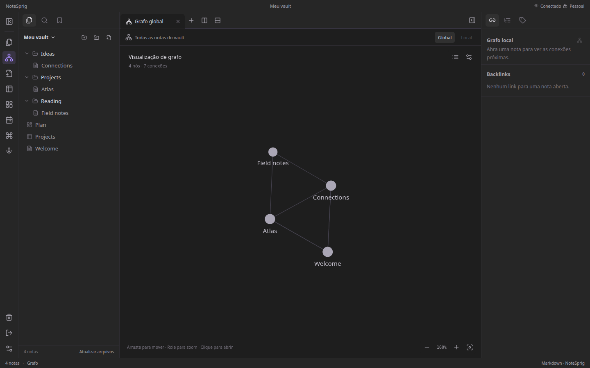
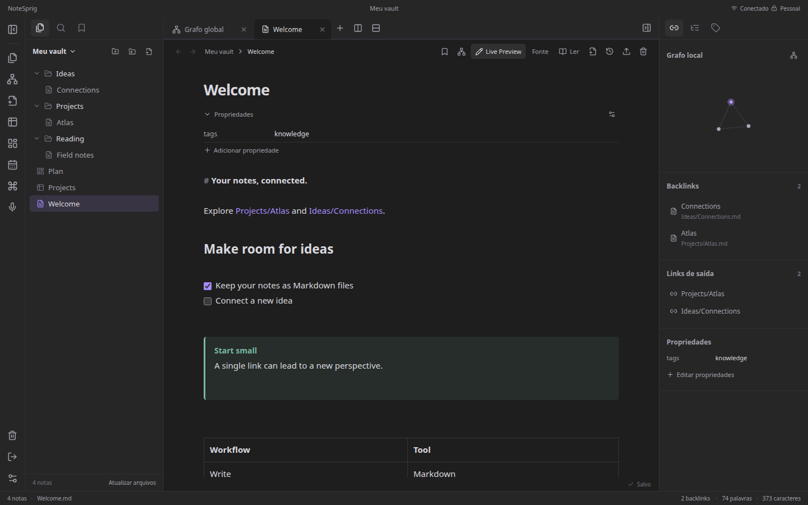
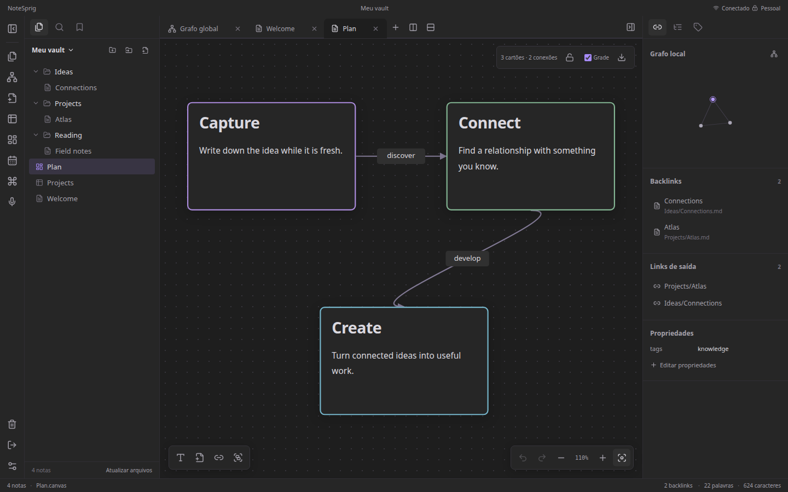
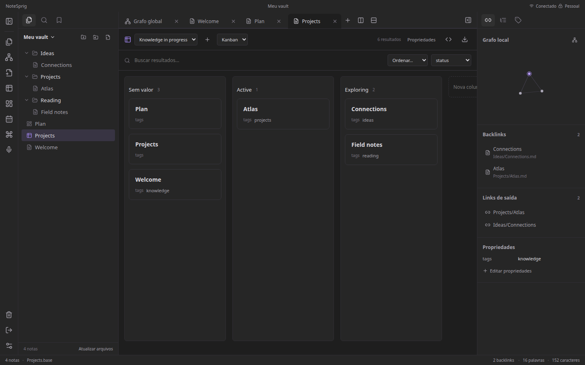

<p align="center">
  
</p>

<h1 align="center">NoteSprig</h1>

<p align="center"><a href="README.md" lang="en">English</a> · <strong>Português (Brasil)</strong></p>

<p align="center"><strong>Suas notas, conectadas.</strong></p>

<p align="center">Um espaço de conhecimento pessoal para conectar notas, organizar ideias e pensar visualmente, hospedado no seu próprio servidor.</p>



O NoteSprig reúne notas Markdown, um grafo de conhecimento, quadros visuais e visualizações estruturadas no navegador. Mantenha seus arquivos no seu servidor e acesse pelo computador ou celular.

**Status:** em desenvolvimento inicial. A interface está disponível em **inglês** e **português do Brasil**. A integração com IA está planejada e ainda não faz parte desta versão.

## Recursos

- **Notas conectadas:** wikilinks, links Markdown relativos, aliases, backlinks, referências a títulos e blocos, tags e busca.
- **Editor Markdown:** modo fonte, Live Preview e leitura, com propriedades, tarefas, tabelas, callouts, código destacado, fórmulas e diagramas Mermaid.
- **Pensamento visual:** grafos global e local com filtros e controles de forças; Canvas com cartões, grupos e conexões.
- **Visualizações estruturadas:** tabelas, listas, cartões e Kanban definidos em YAML, com filtros e fórmulas.
- **Workspace flexível:** pastas, favoritos, abas fixadas, painéis divididos, templates e notas diárias.
- **Recuperação e portabilidade:** histórico, lixeira, tratamento de conflitos, importação e exportação de pastas/ZIP e backups criptografados.
- **Acesso em vários dispositivos:** layout responsivo, PWA instalável e rascunhos locais para edição offline após um primeiro acesso conectado.

O vault utiliza Markdown, JSON Canvas, YAML Bases e arquivos comuns de anexos. Não é necessário configurar um banco de dados externo.

<details>
<summary>Mais capturas</summary>

### Editor Markdown



### Canvas visual



### Visualizações estruturadas



</details>

Todas as capturas do workspace usam notas sintéticas de exemplo.

## Início rápido

Requisitos: **Node.js 22.12+** e npm. Em uma cópia baixada ou clonada do repositório:

```sh
npm ci
npm run dev
```

Abra **http://localhost:5173**. A senha de desenvolvimento é **`dev-only-change-me`**. A API escuta em `127.0.0.1:4317`; os dois serviços de desenvolvimento ficam restritos à máquina local.

Para usar outra senha ou outra pasta:

```sh
NOTESPRIG_DEV_PASSWORD='sua-senha-local' NOTESPRIG_VAULT=/caminho/do/vault npm run dev
```

O vault padrão fica em `data/vault/`, ignorado pelo Git. Use uma cópia ao importar uma coleção existente. O Docker Compose lê `.env`; o processo Node em desenvolvimento usa as variáveis do shell.

### Experimentar a PWA localmente

Compile, pare qualquer API de desenvolvimento que esteja usando a porta 4317 e execute:

```sh
npm run build
npm start
```

Abra **http://localhost:4317**. O service worker é ativado na versão compilada em localhost ou HTTPS. O servidor Vite de desenvolvimento não o registra.

## Idiomas

O inglês é o idioma padrão. Escolha **English** ou **Português (Brasil)** no login ou em **Configurações → Idioma**. A preferência fica salva neste navegador e funciona offline. A troca atualiza a interface e a exibição das datas; não traduz notas, renomeia arquivos ou altera configurações salvas do vault.

O [README principal](README.md) e os guias técnicos estão em inglês. Veja o [guia de idiomas e tradução](docs/i18n.md) para contribuir.

## Hospedagem com Docker

O Compose executa a API e a interface compilada juntas, com dados persistentes. Configure um hash de senha de produção, um segredo de sessão aleatório, permissões do volume e um proxy HTTPS antes de iniciar.

Siga o **[guia de implantação](docs/deployment.md)** para Docker, Cloudflare, backups e restauração. Mantenha a porta do aplicativo restrita ao localhost ou a uma rede privada do proxy.

O GitHub hospeda o código. O GitHub Pages não executa a API Node nem armazena seu vault.

## Limitações atuais

- Um vault pessoal com senha compartilhada; sem contas individuais ou edição colaborativa em tempo real.
- O acesso offline depende dos dados armazenados neste navegador. Limpar o armazenamento remove rascunhos locais. Anexos não armazenados precisam de conexão.
- As notas ficam como arquivos legíveis no servidor. Os dados em uso não possuem criptografia ponta a ponta; os backups têm criptografia própria.
- O layout oferece dois grupos de painéis. A exportação do Canvas é esquemática, e as visualizações estruturadas implementam um subconjunto de fórmulas e layouts.
- Plugins externos não são executados. Clientes nativos e funcionalidades de IA ainda não estão disponíveis.

Consulte o [guia de uso](docs/user-guide.md) e o [roadmap](docs/roadmap.md).

## Desenvolvimento e verificações

```sh
npm run check:docs
npm run check:i18n
npm run notices:check
npx playwright install --with-deps chrome
npm run test:ui
```

Os testes usam vaults temporários com dados sintéticos. No Linux, OpenSSL e GNU tar também são necessários. A CI inclui compilação e verificação da imagem Docker.

Leia [CONTRIBUTING.md](CONTRIBUTING.md) para contribuir e [SECURITY.md](SECURITY.md) para comunicar vulnerabilidades. Relatos em português também são bem-vindos.

## Licença

O código e a documentação originais do NoteSprig usam a [licença MIT](LICENSE). As dependências mantêm suas próprias licenças; consulte os [avisos de terceiros](THIRD_PARTY_NOTICES.md) e os [textos das licenças](docs/legal/THIRD_PARTY_LICENSES.txt).
